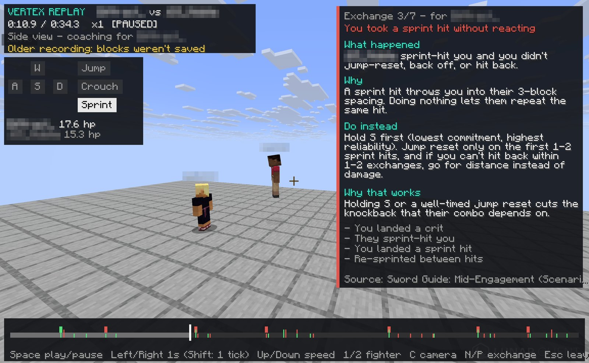
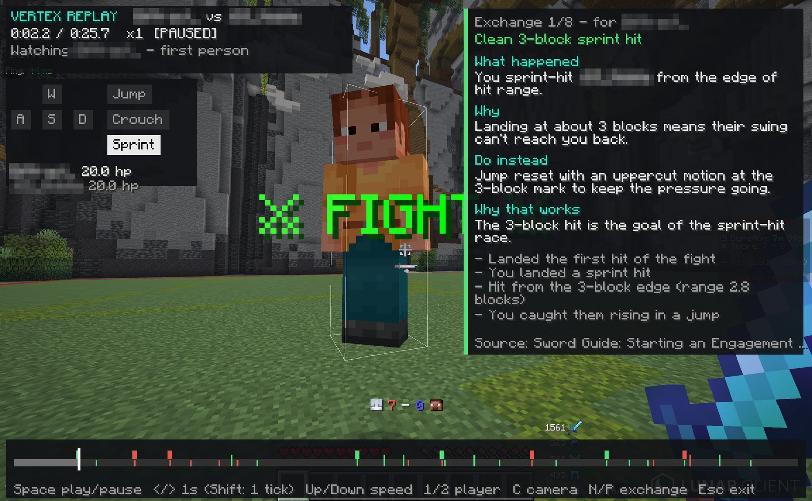
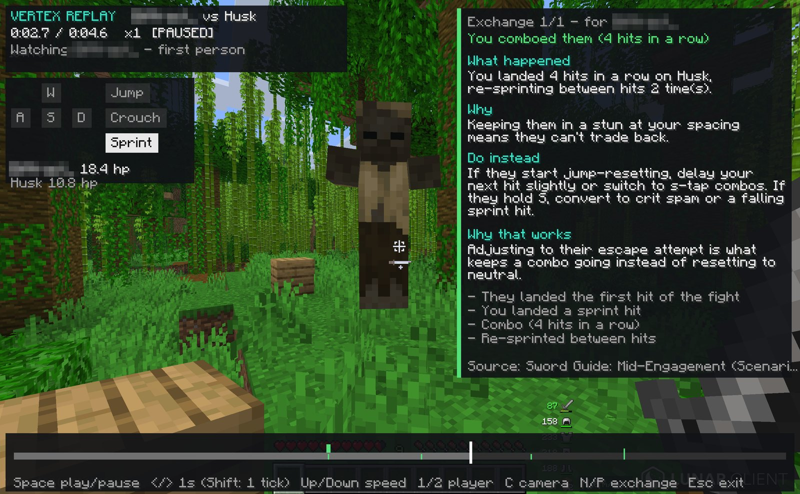
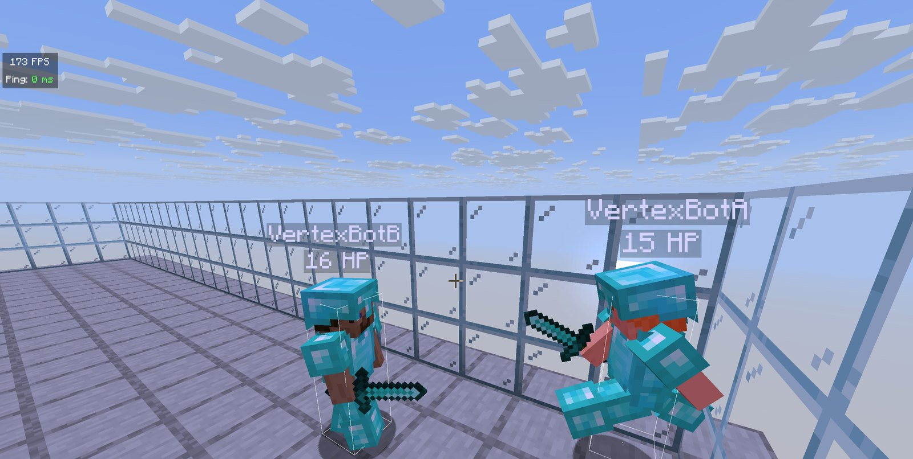
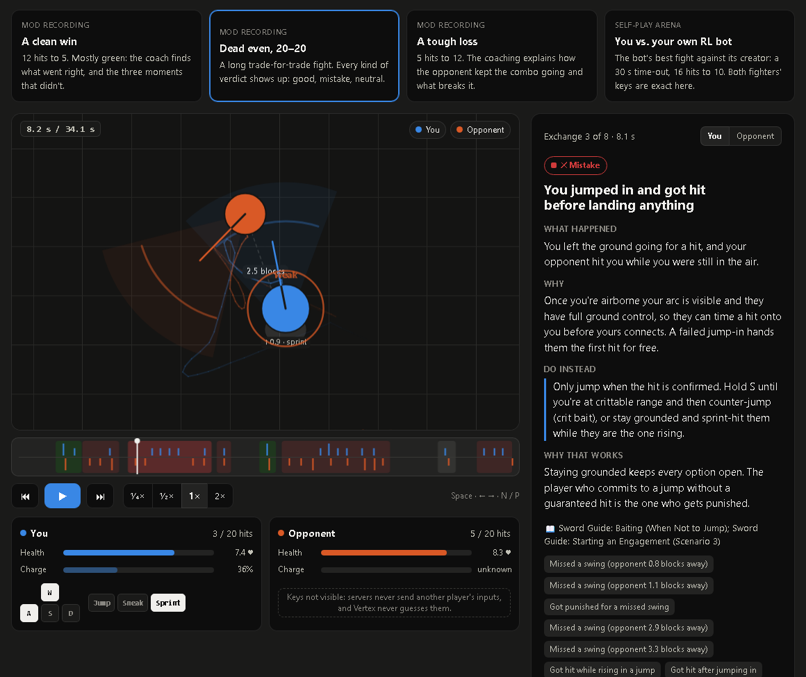
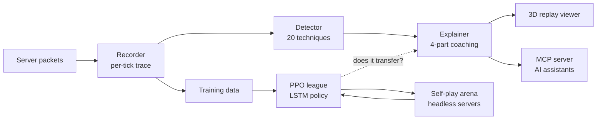

# Vertex: an AI fight coach for Minecraft PvP

**▶ [Live demo: rewatch real fights with the coaching](https://cyrchanh.github.io/vertex-demo/)**. It runs in the
browser with nothing to install. You can also clone the repo and open `index.html`.

Vertex is a Fabric mod for Minecraft 26.2 that records your sword fights from the exact signals the
server sends, replays them in 3D, and coaches every exchange in plain English: *what happened, why,
what to do instead, and why that works*. Behind it is a self-play reinforcement-learning lab, where
bots train on real headless Minecraft servers, built around one research question:

> **Does what a bot learns in self-play actually transfer to people?**



## In the game

| | |
|---|---|
|  |  |
| **First person.** The replay shows that fighter's own view, item and cooldown. This exchange is coached green: *"Clean 3-block sprint hit."* | **Any opponent.** It also works against mobs. Here: *"You comboed them (4 hits in a row)"*, with the next step if they start jump-resetting. |
|  |  |
| **The self-play arena.** Two server-side bots, driven tick by tick from Python, fighting on a real headless server. | **The browser demo.** The same recordings and coaching, played back on the [live demo](https://cyrchanh.github.io/vertex-demo/). |

Player names are blurred in the screenshots.

---

## What I built

| Piece | What it does | Tech |
|---|---|---|
| **Recorder** (client mod) | Read-only hooks on 4 packet handlers. It samples both fighters every tick (positions, velocity, your exact keys and attack charge, items, armour) and the blocks around the fight | Java 21, Fabric, Mixin |
| **Hit classifier** | Pairs each damage packet with the server's crit animation and attack sounds, so CRIT / SPRINT_HIT / WEAK is the *server's* verdict. It also compares that verdict with what your client predicted at the click | Vanilla rules verified with `javap` on the real jar |
| **Detector + explainer** | Groups hits into exchanges and detects 20 techniques (jump resets, S-taps, failed jump-ins, whiff punishes, combos…). A prioritised explainer then writes four-part coaching | Pure-Java `core`, no Minecraft imports, unit-tested |
| **3D replay viewer** | Rebuilds the recorded arena in a private void world. Ghost players act out the fight, with a side camera, first-person view and a timeline | Fabric client APIs |
| **MCP server** | Lets AI assistants query every replay through 7 tools: list fights, drill into an exchange tick by tick, find every time you got hit while rising… | Model Context Protocol, Java |
| **Self-play arena** | A server mod with two real server-player bots, driven one decision at a time from Python over a lockstep socket protocol. Runs at 9–19× real time | Java server mod, Python, PettingZoo |
| **RL training** | PPO with a league (self-play, snapshots, scripted styles, Elo), behaviour-cloning kickstart, curriculum, then distillation into an LSTM with an opponent-prediction head | PyTorch, MLflow |
| **ML pipeline** | Versioned Parquet datasets, hash-locked fight-level splits, a champion gate with fight-resampled confidence intervals, model registry and REST serving | MLflow, scikit-learn, boosted trees |

About 15k lines of Java and Python, with 50 unit tests plus an in-game client test.

## How it fits together



Detailed diagrams: [data flow](docs/data-flow.png) · [package dependencies](docs/package-dependencies.png) ·
[AI training map](docs/ai-training-map.png)

## Engineering decisions worth a look

- **The build enforces the architecture.** The detector and explainer live in `core`, with zero
  Minecraft imports. The MCP server compiles `core` *without* Minecraft on its classpath, so a stray
  import breaks the build. That's what keeps the analysis unit-testable, safe to run on a
  background thread, and reusable by a future server-side recorder.
- **Exact where possible, honest everywhere else.** Who hit whom and the hit type come from server
  signals. Your keys come from your own client. The opponent's keys are never sent to clients, so
  rules that need exact keys only ever fire for the recording player. Nothing is guessed silently,
  and unknown values are explicit (`null`, `−1`, `NaN`), never 0.
- **Latency-aware.** Your hits are timestamped at your click and matched to the confirming packet,
  so replays line up with what you did, not with your ping.
- **Fair bots.** Arena bots see the opponent 200 ms late, like a real client, and use vanilla
  client physics and rules.
- **An `Explainer` interface.** The rule-based coach can be swapped for an AI one without touching
  the recorder, detector, storage or viewer. Each replay records which explainer wrote it.

## Research results so far (pilot scale)

I fought every bot version myself: 9 duels, 45 fights. The bots changed a lot, but I came out
ahead in every fight. More interesting is *why* their skill doesn't reach people:

- **Better on bots, worse on people.** Across 11 checkpoints, the ones whose value head judged bot
  fights better judged my fights *worse* (Spearman ρ = −0.73, p = 0.01, on a duel none had seen).
  No checkpoint beat a plain health-bar baseline on human fights.
- **Measuring the right baseline matters.** The policy's memory seemed to "read" my movement, but
  only when compared against a wiped memory. Simply guessing my most common keys (83.1%) beat
  every checkpoint. I report that as a negative result rather than the flattering one.
- **What does work:** a player model fine-tuned from the bot's network predicts my decisions at 2.44
  vs 4.20 nats for frequencies (90.6% vs 80.6% of movement keys), and its habit report matches my
  real rates within 3 points.

Next is a pre-registered study (fixed probe opponent, metrics fixed in advance) on what makes
self-play knowledge transfer to people, plus LLM coaching whose advice is checked by counterfactual
arena rollouts. Caveat: so far this is one player, 7 traced duels and 35 fights.

## Repository layout

```
index.html, assets/   the interactive demo (static, no build step; GitHub Pages ready)
assets/data.js        4 real fights + research numbers, exported by tools/export_demo.py
source/               a snapshot of the project's code
  src/                  the Fabric client mod (recorder, core analysis, replay viewer)
  mcp-server/           the MCP server (compiles core without Minecraft)
  arena/                the server-side self-play arena mod
  training/             Python: dataset, models, PPO league, LSTM, analysis tools
  README.md             the full technical reference (player guide, formats, exact rules)
  PIVOT_LOG.md          why the project changed direction from v1 to v2, decision by decision
docs/                 architecture diagrams (Mermaid sources included)
```

Privacy: the opponent in the recorded fights is another real player, so their name has been removed
from the demo data.

## Building the mod

Needs Java 21. From `source/`:

```
./gradlew build                 # mod jar → build/libs/vertex-0.2.0.jar, runs the unit tests
./gradlew :mcp-server:jar       # MCP server → mcp-server/build/libs/vertex-mcp.jar
```

Install Fabric Loader 0.19.5+ for Minecraft 26.2 and Fabric API, then drop the jar into `mods/`.
See [source/README.md](source/README.md) for everything else.

---

Built by [cyrchanh](https://github.com/cyrchanh). Not affiliated with Mojang or
Microsoft. [MIT licensed](LICENSE).
