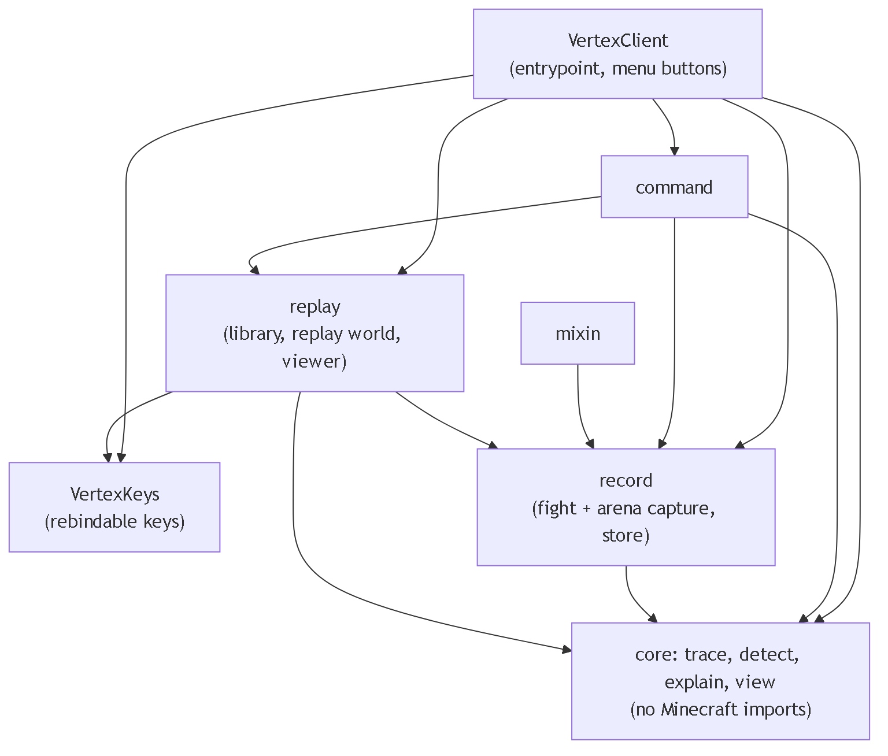
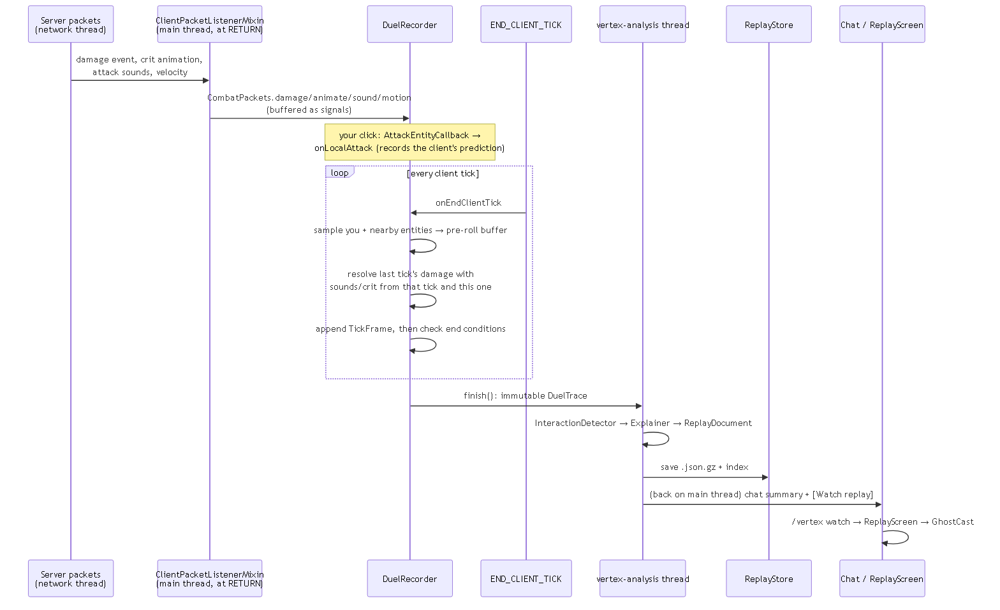

# Vertex — PvP Fight Replays & Coaching

A client-side Fabric mod for Minecraft **26.2**. It records your sword fights from what your client
already receives, then lets you **rewatch each fight as a 3D replay** from either fighter's view,
with **plain-English coaching on every exchange**: what happened, why, what to do instead, and why
that works.

> **Project direction:** this is **v2**. See [PIVOT_LOG.md](PIVOT_LOG.md) for why the project moved
> from v1's live HUD/stat dashboard to replays + coaching, and why it's client-only. v1 is archived separately.
>

- **Post-fight only.** Nothing is shown during a fight. No HUD, no cues, no input automation of any
  kind.
- **Nothing leaves your computer.** Replays are files on your own disk. The mod never sends a packet
  of its own.
- **Exact where it can be.** Who hit whom, crits, sprint hits and knockback come from signals the
  **server** sends every nearby client. Your own keys come straight from your client. Only the
  opponent's held keys are unknown, and the coaching never pretends otherwise.

---

## Table of Contents

1. [Part 1 — Player Guide](#part-1--player-guide)
2. [Part 2 — Developer Reference](#part-2--developer-reference)
3. [Part 3 — Build, Test & Deploy](#part-3--build-test--deploy)
4. [Part 4 — Known Limitations & Honest Caveats](#part-4--known-limitations--honest-caveats)

---

## Part 1 — Player Guide

### Installing

1. Install **Fabric Loader 0.19.5+** for Minecraft **26.2** ([fabricmc.net/use](https://fabricmc.net/use/)).
2. Put the **Fabric API** mod for 26.2 ([Modrinth](https://modrinth.com/mod/fabric-api)) in
   `<.minecraft>/mods/`.
3. Put `vertex-0.2.0.jar` (from `build/libs/`, see [Part 3](#part-3--build-test--deploy)) in the same folder.
4. Launch the "Fabric Loader 26.2" profile.

### When fights are recorded

| Where you are | Recording |
|---|---|
| Singleplayer, or a LAN world you host | **On automatically** |
| Any server | **Off** every time you join. A chat line offers **[Start recording]** (same as `/vertex record on`) |

A fight starts when you hit, or get hit by, another player or mob. It ends after 5 seconds with no
hits, shortly after someone dies, or when the opponent disappears. The ~3 seconds *before* the first
hit are included, so the approach (the neutral game) is part of the replay.

### After a fight

You get a chat message like:

> **Vertex »** You won vs Steve - 34s - landed 9 (3 crit, 2 sprint), took 5 (1 crit, 3 sprint)
> **[Watch replay]** **[Summary]**
>   Biggest thing to fix: You jumped in and got hit before landing anything (x2)
>   Best moment: You landed the first crit

- **[Watch replay]** opens the 3D replay (it asks first, because watching leaves the world or
  server you're in; see below).
- **[Summary]** prints each exchange's verdict and "do instead" advice in chat.

### The replay library

Every recording is kept in the **replay library**, which works without being in any world. So you
can log off a server and still rewatch your fights from the main menu. Open it with:

- the **Vertex Replays** icon button on the **title screen** (in the row of small square buttons,
  after language/accessibility), or the **Vertex Replays** button top-left in the **pause menu**;
- the **J** key (rebindable), when no other screen is open;
- `/vertex library`.

Each row shows the opponent, the hits landed and taken, the result and the date, with **Watch** and
**Delete** buttons (Delete asks "Sure?" first). **Controls...** opens the key binds screen.

### The 3D replay

Like Replay Mod, a replay doesn't depend on where you are now. When you press Watch, Vertex:

1. leaves the world or server you're in (after asking);
2. creates a private, empty **replay world** (no mobs, time frozen at noon; you're an invisible,
   hovering adventure-mode player parked out of shot);
3. **rebuilds the blocks around the fight** from the recording. While you fight, Vertex saves the
   blocks around both fighters (about 12 below to 20 above your feet, across the chunks you
   fought in);
4. re-enacts both fighters with **ghost** copies on that rebuilt arena.

Press **Esc** to leave. The replay world is deleted and you're back in the library. Recordings
made before blocks were saved (older v0.2 files) get a plain floor instead.

The default camera is the **side view**: side-on to the line between the two fighters, like a
fighting game, far enough back to keep both in frame. It stays on the same side even when the
fighters circle or swap places, so the picture never suddenly flips.

| Default key | Action |
|---|---|
| Space | Play / pause (at the end: restart) |
| ← / → | Back / forward 1 second (hold Shift: 1 tick) |
| ↑ / ↓ | Speed: x0.25, x0.5, x1, x2 |
| 1 / 2 | Choose fighter 1 / fighter 2 (whose keys and coaching are shown, and whose eyes the first/third-person cameras use) |
| C | Camera: side view → first person → third person |
| N / P | Jump to the next / previous exchange |
| Esc | Leave the replay |

**Every key except Esc can be rebound:** Options → Controls → Key Binds → **Vertex Replay** (or
**Controls...** in the library). The on-screen hint always shows your current keys. The replay keys
only work while a replay is open, so sharing a key with vanilla (Space, 1, 2) is fine.

On screen:
- **Top left:** time, speed, camera, and which fighter is selected.
- **Left:** that fighter's **held keys** (W/A/S/D, jump, crouch, sprint) for your own side; "not
  visible" for the opponent. Below that, both fighters' health and **attack charge** bars (green =
  fully charged). A `~` means estimated: nobody's client receives the opponent's charge, so it's
  worked out from their swings and held item the way vanilla computes it.
- **First person** looks like that fighter's own screen: their **held item** in hand (with its
  swing, the dip after attacking, and enchantment glint) and vanilla's **attack cooldown indicator**
  under the crosshair. The coaching panel is shorter in this mode so the item stays visible.
  Recordings from before v0.2's held-item update show an empty hand. Your own health, food, XP
  and hotbar are hidden during replays.
- Ghosts hold their recorded items in every camera mode.
- **Right:** the coaching for the current exchange, color-coded green (good), red (mistake) or
  yellow (neutral). It has four parts (*What happened / Why / Do instead / Why that works*), plus
  notes and the guide section the advice comes from.
- **Bottom:** the timeline. Colored marks are exchanges; thin ticks are hits (green = yours,
  red = theirs, taller = crit).

### Commands

All `/vertex` commands run on your computer only; they're never sent to the server.

| Command | What it does |
|---|---|
| `/vertex record` | Toggle recording (`/vertex record on` / `off` to set it) |
| `/vertex library` | Open the replay library |
| `/vertex replays` | List your recent replays in chat, with clickable [Watch] / [Summary] |
| `/vertex watch latest` (or an id) | Open the 3D replay (in the replay world) |
| `/vertex summary latest` (or an id) | Print the coaching in chat |

### Where your replays are

`<.minecraft>/vertex-replays/<id>.json.gz`, plus `index.json`. Delete them from the library, or
delete the file. While you're watching, a temporary `saves/vertex-replay` world exists; it's
deleted when you leave the replay.

### Ask an AI about your fights (MCP)

`mcp-server/` is a small separate program that lets AI apps that support **MCP** (Model Context
Protocol), such as Claude Code or Claude Desktop, read your replays. It's read-only and runs only
on your computer.

1. Build it once: `./gradlew :mcp-server:jar` → `mcp-server/build/libs/vertex-mcp.jar`. It needs
   Java 21+.
2. **Claude Code:** the project's `.mcp.json` already registers it as `vertex-replays`. Open
   Claude Code in this folder and approve the server when asked.
   **Other apps:** run `java -jar vertex-mcp.jar` (add `--replays <folder>` if your replays aren't
   in `%APPDATA%\.minecraft\vertex-replays`).
3. Ask things like *"What's my most common mistake in my last 10 fights?"*, *"Show me every time I
   got hit while rising"*, or *"Walk me through exchange 3 of my latest fight tick by tick."*

| Tool | What it gives the AI |
|---|---|
| `list_replays` | Your fights: date, opponent, result, hit counts |
| `get_replay` | One fight: every hit (server's verdict, range, knockback) and each exchange's coaching headline |
| `get_exchange` | One exchange: techniques, full coaching for both fighters, tick-by-tick timeline (keys, vertical speed, charge, swings, distance) |
| `get_frames` | Raw timeline for any tick range (max 200 ticks per call) |
| `find_moments` | Every occurrence of a technique across all fights (e.g. `FAILED_JUMP_IN` for you) |
| `get_stats` | Totals across fights: wins, hits by kind, technique counts, most common mistakes/strengths |
| `list_techniques` | The detector's exact rule for every technique |

### What's exact and what's estimated

| Fact | Source | Exact? |
|---|---|---|
| Your position, movement per tick, keys, attack charge | Your own client | Exact |
| Who hit whom | Server damage-event packet (names the attacker) | Exact |
| Crit / sprint hit / normal / weak | Server's attack sounds + crit animation | Exact (server's verdict) |
| Knockback you dealt / took | Server velocity packet | Exact |
| What *your client* expected (crit? sprint?) | Vanilla's rules at your click | Exact; compared with the server's verdict |
| Opponent position, rotation, sprinting, crouching | Server updates to your client | Exact as last sent, smoothed by vanilla |
| Opponent movement per tick | Change in their position as seen by your client | Estimated (smoothed, delayed by ping) |
| Opponent's held keys and attack charge | Not sent to clients | **Unknown** |

---

## Part 2 — Developer Reference

### Package layout

```
com.vertexpvp.vertex
├── VertexClient              entrypoint: wiring, recording policy, post-fight chat message, menu buttons
├── VertexKeys                rebindable key mappings ("Vertex Replay" category)
├── command/VertexCommands    /vertex client commands
├── mixin/                    ClientPacketListenerMixin (read-only hooks on 4 packet handlers),
│                             GameRendererMixin (hand off outside first person), LivingEntityAccessor
├── record/                   Minecraft-facing recording (main thread)
│   ├── CombatPackets         static bridge: mixin → recorder
│   ├── DuelRecorder          fight lifecycle, per-tick sampling, packet → hit resolution
│   ├── FrameSampler          entity → ParticipantFrame
│   ├── ClientCritRules       vanilla 26.2 crit/sprint rules, for the client's own prediction
│   ├── ArenaRecorder         captures the blocks around the fight, a few chunk columns per tick
│   └── ReplayStore           .json.gz files + index.json on disk
├── replay/                   the 3D replay viewer
│   ├── ReplayLibraryScreen   list / watch / delete recordings, link to key binds
│   ├── ReplayWorld           private void world: create, rebuild arena, open viewer, leave + delete
│   ├── ReplayScreen          playback, camera modes, overlay, controls
│   ├── CameraRig             invisible client-only entity the side camera looks through
│   ├── HeldItems             recorded item id -> ItemStack, attack delay from its attributes
│   └── GhostCast             client-only ghost entities that act the fight out
└── core/                     NO Minecraft imports: unit-testable, reusable by a future server recorder
    ├── trace/                DuelTrace, TickFrame, ParticipantFrame, ParticipantInfo, CombatEvent, ControlInput, Arena, ArenaColumn
    ├── view/                 SideCamera (side-on camera maths), AttackCharge (cooldown, exact or estimated)
    ├── detect/               InteractionDetector, Interaction, Observation, Technique
    ├── explain/              Explainer (interface), RuleBasedExplainer, Explanation, SummaryBuilder
    ├── ReplayDocument        trace + interactions + explanations (what's saved)
    └── ReplayCodec           gzip JSON encode/decode
```

A second Gradle subproject, `mcp-server/` (`com.vertexpvp.vertex.mcp`: `VertexMcpServer`,
`ReplayTools`, `ReplayLibrary`), compiles `core` straight from `src/main/java` **without Minecraft
on its classpath**. So its build fails if `core` ever picks up a Minecraft import.

`core` depending on nothing Minecraft-specific is the most important structural rule: it's what
lets the detector and explainer be unit-tested, run on a background thread safely, and be reused
unchanged by a future server "lab" recorder (see [PIVOT_LOG.md](PIVOT_LOG.md) R5).



<sub>Source: [docs/diagrams/package-dependencies.mmd](../docs/package-dependencies.mmd) (see [Editing diagrams](#editing-diagrams))</sub>

### Data flow



<sub>Source: [docs/diagrams/data-flow.mmd](../docs/data-flow.mmd)</sub>

### How a hit is classified (exact rules)

Every landed hit pairs **one damage-event packet** (`entityId` = victim, `sourceCauseId` =
attacker) with the classification signals from the same or the next tick:

| Server signal | Result |
|---|---|
| `CRITICAL_HIT` animation on the victim, or a `PLAYER_ATTACK_CRIT` sound at the attacker | `CRIT` |
| `PLAYER_ATTACK_KNOCKBACK` at the attacker | `SPRINT_HIT` |
| `PLAYER_ATTACK_WEAK` at the attacker | `WEAK` |
| `PLAYER_ATTACK_STRONG` / `_SWEEP` at the attacker | `STRONG` |
| attacker isn't a player | `MOB` |
| none arrived | `UNKNOWN` (`serverConfirmed = false`) |

A sound is attributed to whichever fighter stood closest to where it played (within 3 blocks).
Vanilla plays these sounds at the attacker's position with no excluded player, so the attacker
hears their own too (verified in `Player.playServerSideSound` bytecode).

For **your** hits, the client also records what it *expected* at the moment of the click
(`predictedKind`), using vanilla 26.2's exact rules read from `Player.attack` /
`Player.canCriticalAttack`:

- **strong** = `getAttackStrengthScale(0.5f) > 0.9`
- **crit** = strong, `fallDistance > 0`, not on ground, not climbing, not in water, not blind
  (`isMobilityRestricted`), not riding, target is a living entity, **not sprinting**
- **sprint hit** = strong **and** sprinting

So a crit and a sprint hit can never be the same hit. When the server's verdict differs from your
client's prediction (latency/desync), the detector flags `SERVER_DISAGREED`.

Your hits are time-stamped at your **click** (matched to the damage packet that confirms it), not at
packet arrival, so the replay lines up with what you did rather than with your ping.

### The trace format (`core/trace`)

| Record | Contents |
|---|---|
| `DuelTrace` | `formatVersion` (now **3**), `id`, `source` (`"client"`), start time, dimension, 2 `ParticipantInfo`s, `frames`, `events`, `endReason`, `winner`, `arena` (null in v1 files), `context` (null before v3) |
| `RecordingContext` | `gameVersion`, `modVersion`, `server` (address from the server list; null in singleplayer), `serverBrand` (e.g. `Paper`), `singleplayer` |
| `Arena` / `ArenaColumn` | the captured blocks: one entry per 16×16 chunk column (`chunkX/Z`, `minY`, `height`), each a `palette` of block-state strings (`minecraft:oak_stairs[facing=east,...]`) plus run-length `runs` (palette index, count) in y→z→x order. Places that weren't captured read as `null` (unknown), not air |
| `ParticipantInfo` | `index` (0/1), `name`, `player`, `entityType`, `recorder` (true = whose keys are exact) |
| `TickFrame` | `tick` + one `ParticipantFrame` per participant |
| `ParticipantFrame` | position, yaw/pitch/head/body rotation, velocity, `onGround`, `sprinting`, `sneaking`, `input` (`ControlInput` or **null** = unknown), `health`, `attackStrength` (−1 = unknown), `fallDistance`, `swingStart`, `hurtTime`, `mainHand` (item id; `minecraft:air` = empty; **null** = not recorded), `mainHandFoil`. Format 3 adds, for both fighters: `offHand`, `armor` (head → feet), `absorption`, `usingItem`, `pingMs` (from the player list; null for mobs). For the recorder only (null for the opponent, because servers don't send them): `selectedSlot`, `effects` (`EffectState`: `id`, `amplifier`, `durationTicks`, −1 = infinite) |
| `CombatEvent` | `tick`, `type` (`HIT` / `NO_DAMAGE` / `DEATH`), `attacker`, `victim`, `kind`, `predictedKind`, `serverConfirmed`, `range`, knockback x/y/z (NaN = not seen) |

Tick convention: `frames.get(t)` is the state at the **end** of tick `t`, so the state just
*before* an event at tick `t` is `frames.get(t − 1)`. Unknown values are explicit (`null`, `−1`,
`NaN`), never silently 0.

### The detector (`InteractionDetector`)

Landed hits with gaps of ≤ 20 ticks form one **exchange** (`Interaction`), padded by 10 ticks
either side. Each exchange gets `Observation`s:

| Technique | Rule | Needs exact keys? |
|---|---|---|
| `FIRST_HIT` | first landed hit of the fight | no |
| `CRIT_LANDED` / `SPRINT_HIT_LANDED` / `WEAK_HIT` | server classification | no |
| `FALLING_SPRINT_HIT` | sprint hit while the attacker was airborne and falling | no |
| `SPRINT_RESET` | a follow-up sprint hit by the same attacker (vanilla ends sprint after a sprint hit, so they re-sprinted) | no |
| `NO_SPRINT_RESET` | a charged follow-up that was neither crit nor sprint hit | no |
| `THREE_BLOCK_HIT` / `CLOSE_RANGE_HIT` | range ≥ 2.6 / ≤ 1.6 blocks | no |
| `HIT_WHILE_RISING` | victim airborne with upward speed > 0.05 when hit | no (marked *estimated* for the opponent) |
| `FAILED_JUMP_IN` | victim left the ground with real upward speed in the last 15 ticks, still airborne, landed nothing since | no (marked *estimated* for the opponent) |
| `CROUCHING_WHEN_HIT` | victim crouching when hit | no |
| `COMBO` | ≥ 3 hits in a row by one side | no |
| `TRADE` | both sides landed hits in the exchange | no |
| `WHIFF` / `WHIFF_PUNISHED` | a swing matching no hit within 2 ticks, opponent within 5 blocks / followed by their hit within 15 ticks | no |
| `SERVER_DISAGREED` | client prediction ≠ server verdict, and one of them was a crit/sprint hit | no |
| `S_TAP` | back held 1–4 of the 8 ticks before a hit, released by the hit | **yes** |
| `JUMP_RESET` | grounded just before the hit, jump held from 1 tick before to 2 after | **yes** |
| `BACKED_OFF_AFTER_HIT` | back held ≥ 2 of the 6 ticks after a hit | **yes** |
| `NO_RESPONSE` | took a sprint hit with no jump reset, backing off, or hit back within 12 ticks | **yes** |

Rules needing exact keys **only ever fire for the recording player**. They're not guessed for the
opponent, because knockback motion makes those guesses unreliable.

### The explainer (`RuleBasedExplainer`)

For each exchange and each **player** (mobs aren't coached), the first matching rule becomes the
main explanation. Mistakes are checked before strengths, so the most useful correction surfaces
first:

1. Failed jump-in → 2. Hit while rising → 3. Whiff punished → 4. No response to a sprint hit →
5. Got comboed → 6. Weak hit → 7. No sprint reset → 8. First crit (good) → 9. Your combo (good) →
10. Jump reset / backed off (good) → 11. Crit (good) → 12. Falling sprint hit (good) →
13. 3-block sprint hit (good) → 14. They crit you (neutral, with counters) → 15. Exchange score.

Each `Explanation` has `headline`, `what`, `why`, `instead`, `insteadWhy`, `source` (guide +
section), `notes` (every other recognised technique, one line each), `verdict`, and `inferred` (the
main point relies on estimated data). The advice text is written from the project owner's three
Sword guides (Baiting, Starting an Engagement, Mid-Engagement).

**Swapping in an AI later:** implement `core.explain.Explainer` (`id()` +
`explain(trace, interactions)`) and pass it to `DuelRecorder` in `VertexClient`. The recorder,
detector, storage and viewer don't change. Each replay records which explainer wrote it
(`explainerId`).

### The replay viewer (`ReplayWorld`, `ReplayScreen`, `GhostCast`, `CameraRig`)

- **Arena capture (`ArenaRecorder`):** whenever a fighter is near a chunk column that isn't
  captured yet, it and its 8 neighbours are queued. Up to 3 loaded columns are read per tick
  (`ClientLevel.getBlockState`, serialized with `BlockStateParser.serialize`), 64 columns max.
  The height range is fixed at fight start: 12 below to 20 above your feet.
- **Replay world (`ReplayWorld`):** a small state machine (`CREATING → BUILDING → WAITING →
  WATCHING`). It leaves the current world (`Minecraft.disconnectFromWorld`, which waits for the
  built-in server to stop), deletes any old `saves/vertex-replay`, and calls
  `WorldOpenFlows.createFreshLevel` with the `THE_VOID` flat preset, adventure mode, peaceful and
  cheats on. On join it disables recording, freezes time/weather/mob spawning
  (`GameRules.ADVANCE_TIME`, …), and rebuilds the arena on the server thread with
  `Level.setBlock(..., UPDATE_CLIENTS | UPDATE_KNOWN_SHAPE | UPDATE_SUPPRESS_DROPS)`, so neighbours
  don't reshape the recorded states. It then parks you, invisible and flying, 30 blocks above the fight (so the
  chunks load, out of shot) and opens `ReplayScreen` once the chunk has arrived on the client.
  Esc → `leave()` → disconnect, delete the save, show the library.
- **Side camera (`core.view.SideCamera` + `CameraRig`):** pure maths. The camera sits on the
  perpendicular `(−dz, dx)` of the fighter-to-fighter line, at distance `clamp(1.1·gap + 4, 5, 16)`
  and 1.2 blocks above eye height, looking at the midpoint. It keeps its side by flipping the
  perpendicular whenever it points against last tick's, and eases 30 % per tick. Minecraft can only
  look through an entity, so `CameraRig` is an invisible client-only `RemotePlayer` (id −1 000 100)
  moved with the same one-tick interpolation as the ghosts. Yaw is unwrapped so ±180° never spins.
- **First-person item and cooldown:** vanilla draws the first-person hand, held item, swing and
  crosshair cooldown indicator from `Minecraft.player`, and only outside spectator mode
  (`GameRenderer.renderItemInHand`). So in the replay world you're adventure-mode (invisible,
  flying, invulnerable). Each tick in first person, `ReplayScreen.drivePointOfView` copies the
  watched fighter's item into your slot 0 and calls `swing()` on recorded swings. It then matches
  your `ATTACK_SPEED` to the item (from its `ATTRIBUTE_MODIFIERS`) and sets `attackStrengthTicker`
  (accessor mixin) to the fighter's charge. `core.view.AttackCharge` gives that charge: exact for
  you, estimated for the opponent (resets on swing or item switch, refills over 20 / attack speed
  ticks). `GameRendererMixin` cancels the hand in side and third-person views. Fabric
  `HudElementRegistry.replaceElement` hides your own health/food/XP/effects/hotbar, and the
  crosshair outside first person.
- **Title-screen button:** a 20×20 `SpriteIconButton` (sprite `vertex:icon/replays`,
  `assets/vertex/textures/gui/sprites/icon/replays.png`). It's placed 24 px right of the lowest,
  right-most 20×20 widget already on the title screen, so it follows other mods' layout changes.
- **Keys (`VertexKeys`):** `KeyMapping`s registered with Fabric's `KeyMappingHelper` in a
  `KeyMapping.Category.register(vertex:replay)` category; `ReplayScreen.keyPressed` checks
  `mapping.matches(KeyEvent)`. In 26.2 a key can have several mappings (`KeyMapping.MAP` is
  key → list), so sharing Space/1/2 with vanilla doesn't break vanilla.

- **Ghosts:** players are `RemotePlayer`s (the class vanilla uses for other players), mobs are
  created from their recorded entity type. They're added to the client world with negative ids and
  fresh random UUIDs. Duplicate UUIDs are silently refused by the client's entity storage, and fresh
  ones are why ghosts show the default skin. Interpolation length is 1 tick, and render-time
  interpolation does the smoothing. Swings and hurt flashes replay from `swingStart` / `hurtTime`.
- **Camera:** `Minecraft.setCameraEntity(rig or ghost)` + `Options.setCameraType(...)`; restored in
  `removed()`.
- **No background:** the screen overrides `extractBackground` to draw nothing (no blur/dim) so the
  world is fully visible.
- **Opening from chat:** commands act via `VertexClient.openNextTick` / `runNextTick`, because the
  chat screen closes itself right after running a command.

### Threading

- **Main thread:** mixin hooks (after vanilla's own thread hop), all sampling, all resolution, all
  rendering, all chat.
- **`vertex-analysis` thread:** detector + explainer + save, on an immutable `DuelTrace`. It hands
  the result back with `Minecraft.execute`. Never touch live Minecraft objects there.

### Verified Minecraft 26.2 / Fabric API reference

Everything below was confirmed with `javap` against the real remapped 26.2 jar and Fabric API
0.161.0+26.2 jars before use. If you port to a newer version, re-verify; don't assume.

| Purpose | API |
|---|---|
| Packet hooks | `ClientPacketListener.handleDamageEvent / handleAnimate / handleSoundEvent / handleSetEntityMotion` |
| Damage source | `ClientboundDamageEventPacket.entityId() / sourceCauseId()` (record) |
| Crit animation | `ClientboundAnimatePacket.getId() / getAction()`, `CRITICAL_HIT` |
| Attack sounds | `ClientboundSoundPacket.getSound().value().location()`, `getX/Y/Z()`; `SoundEvents.PLAYER_ATTACK_*` |
| Knockback | `ClientboundSetEntityMotionPacket.id() / movement()` (record) |
| Your exact keys | `LocalPlayer.input.keyPresses` → `Input(forward, backward, left, right, jump, shift, sprint)` |
| Attack charge | `Player.getAttackStrengthScale(float)` |
| Swing state | `LivingEntity.swinging`, `swingTime` (public fields) |
| Ghosts | `new RemotePlayer(ClientLevel, GameProfile)`; `GameProfile(UUID, String)` is a record; `ClientLevel.addEntity / removeEntity(int, RemovalReason)` |
| Ghost motion | `Entity.moveOrInterpolateTo(Vec3, yRot, xRot)`, `snapTo(...)`, `LivingEntity.getInterpolation()`, `InterpolationHandler.cancel() / setInterpolationLength(int)` |
| Camera | `Minecraft.setCameraEntity / getCameraEntity`, `Options.setCameraType(CameraType)` |
| Screens | `Screen.extractRenderState(GuiGraphicsExtractor, int, int, float)`, `extractBackground(...)`, `keyPressed(KeyEvent)`, `rebuildWidgets()`, `Minecraft.setScreenAndShow(Screen)`, current screen via `Minecraft.gui.screen()` |
| Menu buttons | Fabric `ScreenEvents.AFTER_INIT`, `Screens.getWidgets(screen)`, `Button.builder(...).bounds(...)`, `ConfirmScreen`, `KeyBindsScreen(Screen, Options)` |
| Keys | `new KeyMapping(String, InputConstants.Type, int, KeyMapping.Category)`, `KeyMapping.Category.register(Identifier)` (label key `key.category.<ns>.<path>`), Fabric `KeyMappingHelper.registerKeyMapping`, `matches(KeyEvent)`, `consumeClick()` |
| Replay world | `Minecraft.createWorldOpenFlows().createFreshLevel(id, LevelSettings, WorldOptions, Function<HolderLookup.Provider, WorldDimensions>, Screen)`, `WorldPresets.createNormalWorldDimensions`, `WorldDimensions.replaceOverworldGenerator`, `FlatLevelGeneratorPresets.THE_VOID`, `Minecraft.disconnectFromWorld(Component)`, `getLevelSource().getBaseDir()` |
| Blocks | `BlockStateParser.serialize(BlockState)` / `parseForBlock(HolderLookup<Block>, String, false)`, `Level.setBlock(BlockPos, BlockState, int)`, `GameRules.set(rule, value, server)` |
| Chat | `Minecraft.gui.hud.getChat().addClientSystemMessage(Component)` |
| Client commands | `ClientCommandRegistrationCallback`, `ClientCommands.literal / argument` |
| Entity types | `BuiltInRegistries.ENTITY_TYPE.getValue(Identifier)`, `EntityType.create(Level, EntitySpawnReason)` |

---

## Part 3 — Build, Test & Deploy

Requirements: **Java 25+** (the project compiles with `--release 25`; a JDK 26 works too), Gradle via
the included wrapper.

```bash
./gradlew build                 # -> build/libs/vertex-0.2.0.jar
./gradlew test                  # JUnit: detector, explainer, file format, summaries, arena, side camera (no Minecraft needed)
./gradlew runClientGameTest     # launches a REAL Minecraft client and runs the end-to-end test
```

**OneDrive note:** this project folder is inside OneDrive, which locks freshly written files while
it uploads them and makes Gradle fail with "Unable to delete directory … build\classes". Either move
the project out of OneDrive, or redirect build output:

```bash
./gradlew build -PvertexBuildDir="C:/Users/<you>/AppData/Local/vertex-build"
```

### Editing diagrams

The README shows diagrams as PNG images so they display everywhere, including VS Code's built-in
preview, which doesn't render Mermaid. Each image has an editable Mermaid source in
`docs/diagrams/*.mmd`. After editing a source, re-render it with the official Mermaid CLI:

```bash
npx -p @mermaid-js/mermaid-cli@11.4.2 mmdc -i docs/diagrams/data-flow.mmd -o docs/diagrams/data-flow.png -b white -s 2
```

Rendering also catches syntax errors. One rule that bit this project: **don't use `;` inside
Mermaid labels or messages**, because it ends the statement.

### What the end-to-end game test does (`src/gametest`)

`runClientGameTest` opens a Minecraft window, then on its own:
1. creates a world, builds a stone platform, and spawns a husk with no AI;
2. checks recording switched on automatically (singleplayer);
3. lands a **normal hit**, a **jump crit** (swinging on the way down) and a **sprint hit**
   (running at the target), all with real simulated key presses;
4. waits for the fight to end and checks the saved replay: 3 hits, all server-confirmed, kinds
   exactly `STRONG`, `CRIT` and `SPRINT_HIT`; knockback attached; pre-roll recorded; interactions and
   coaching produced; readable back from disk; the platform's blocks captured in the arena;
5. **leaves the world** (like being warped away or logging off), screenshots the title screen's
   Vertex Replays button, opens the library and checks the recording is listed;
6. watches it: checks it opened in the separate "Vertex Replay" world, the stone platform was
   rebuilt there, recording is off, 2 ghosts are playing, and the default camera is the side view;
   presses C (default binding) and checks first person, then third person; jumps to an exchange;
   screenshots each;
7. leaves the replay world and checks it was closed and its save deleted, landing in the library.

Step 7 calls `ReplayWorld.leave()` through `runOnClient` instead of pressing Esc. Leaving waits for
the built-in server to stop, and the test harness only lets the server tick while the test thread
waits in `runOnClient`. Pressing Esc inside the harness therefore hangs it, while in normal play it
behaves like vanilla's "Save and Quit".

Screenshots land in `build/run/clientGameTest/screenshots/`. Because that run folder is also inside
the project, OneDrive can lock it between runs; if `deleteGameTestRunDir` fails, delete
`build/run/clientGameTest` and run again.

### What was actually verified

**2026-11-04 (recorder upgrade, format 3):**
- **Unit tests:** 38/38 (2 new: format 3 fields survive saving; a format 2 file loads with the new
  fields unknown, not zero). MCP server 12/12.
- **Real-client game test: passes.** It now gives the player an iron helmet, a totem in the off
  hand and Luck II, gives the husk a golden helmet, and checks that all of them, the hotbar slot,
  ping (0 ms in singleplayer) and the recording context (`26.2`, Vertex `0.2.0`, brand `fabric`,
  singleplayer) are saved, and that the husk's effects, ping and slot stay unknown. In the side-view
  screenshot both ghosts wear their recorded helmets.

**2026-10-30 (title icon, first-person item + cooldown):**
- **Unit tests:** 36/36 (4 new: exact/estimated attack charge, item-switch reset, old files have no
  item, held item survives saving). MCP server 12/12.
- **Real-client game test: passes**, now fighting with a wooden sword. The held item was recorded
  (`minecraft:wooden_sword`; the husk's `minecraft:air`). The Vertex icon button is on the title
  screen, in the row after vanilla's three icon buttons. In first person your hand held the wooden
  sword. 3 ticks after the first hit the charge was below 0.9 and vanilla dipped the sword; before
  the hit it was full, with the sword in view and the "ready" cooldown icon under the crosshair.
  The side view showed the ghost holding its sword. Screenshots were checked by eye.
- **Found by looking:** the coaching panel covered the bottom-right, where vanilla draws the held
  item, so in first person the panel now stops halfway down.

**2026-10-29 (replay world, library, side camera, keys):**
- **Unit tests:** 32/32 pass (16 detector, 6 explainer, 4 file format/summary, 6 arena + side camera).
  MCP server: 12/12.
- **Real-client game test: passes.** The arena captured 12 chunk columns, 153 solid blocks: exactly
  the 9×17 test platform. After the test world was closed, the replay opened from the main menu
  in a fresh void replay world with the platform rebuilt ("replay world ready (153 arena
  blocks)"). Screenshots checked by eye: Vertex Replays button on the title screen; library row
  with Watch/Delete; side view showing both fighters side-on in the clear gap between the overlay
  panels (fighter 1 left, fighter 2 right); first/third person; annotation. The save folder was
  deleted after leaving.
- **Found and fixed by looking at the screenshots:** the first side-view framing centred the
  fight, which put the opponent behind the coaching panel. The camera now aims off-centre into
  the clear gap (`SideCamera.setFraming`). The `time set noon` chat line was silenced, and key
  names were shortened in the hint ("Left" instead of "Left Arrow").
- **Not yet verified:** pressing Esc in real play (see above), and a recording made on a real
  server, then watched after logging off.

**2026-10-28 (v2):**

- **Unit tests:** 26/26 pass (16 detector, 6 explainer, 4 file format/summary).
- **Real-client game test: passes.** Recorded in a real Minecraft 26.2 client:

  | Scripted action | Recorded kind | Client predicted | Range | Knockback applied |
  |---|---|---|---|---|
  | Normal hit | `STRONG` (server-confirmed) | `STRONG` | 2.70 | 0.40 |
  | Jump crit | `CRIT` (server-confirmed) | `CRIT` | 2.89 | 0.40 |
  | Sprint hit | `SPRINT_HIT` (server-confirmed) | `SPRINT_HIT` | 2.95 | **0.70** |

  The extra sprint knockback and the crit's normal knockback match vanilla. The 3D replay opened
  directly and via `/vertex watch latest`, both ghosts played, and the camera/ghost cleanup was
  confirmed. The screenshots were checked by eye: ghost player and husk in the world, held-keys
  panel lighting W + Sprint on the sprint hit, coaching panel, timeline.
- **A real finding from testing:** the first crit attempt swung on the very first falling tick and
  the server (and the client's prediction) correctly counted it as a normal hit. Vanilla processes
  the click before that tick's movement, so `fallDistance` is still 0 at the apex. The recording
  showed this exactly (`fallDistance` 0.000 at the apex, 0.075 one tick later).
- **Not yet verified:** a real multiplayer server (only singleplayer was tested, where packets
  still go through the same client packet handlers), and a fight against another real player.

---

## Part 4 — Known Limitations & Honest Caveats

- **Opponent keys are unknown.** Jump resets, S-taps, backing off and "no response" are only
  detected for you. Where the coaching relies on the opponent's estimated motion, it says
  "Partly estimated".
- **Opponent motion is your client's view of them.** It's smoothed by vanilla interpolation and
  delayed by your ping; it isn't what the server simulated.
- **1v1 only.** A fight is you vs one opponent. Hits from or on anyone else during that fight are
  ignored.
- **Sound attribution uses position.** If both fighters stand within a fraction of a block of each
  other, an attack sound could be attributed to the wrong one. The damage packet's attacker id is
  still exact, so this can only affect the hit *type*, never *who hit whom*.
- **Ghosts use default skins.** Fresh UUIDs are required for client-only entities, and skins are
  looked up by UUID.
- **The arena is a snapshot of nearby blocks.** Blocks are captured as your client saw them while
  the fight was on, within the captured height range and up to 64 chunk columns. Entities that
  aren't the two fighters (other players, item frames, arrows), block-entity contents (sign text,
  banners' patterns) and blocks that changed mid-fight aren't replayed. Fluids and falling blocks
  are placed as recorded and may settle slightly in the replay world.
- **Watching leaves your current world or server.** That's what makes replays work anywhere. Vertex
  asks before doing it.
- **Intent isn't detected.** "They backed off right before your swing" is observable. "They baited
  you" is not, and the coaching won't claim it.
- **The coaching is rules, not AI (yet).** Testing against a real player confirmed it's too simple
  to read a real fight well. That's deliberately left for the AI training step rather than patched
  with more rules. The plan is to train first, then embed the trained model in the mod behind the
  same `Explainer` interface; see the explainer section and [PIVOT_LOG.md](PIVOT_LOG.md).

---

Vertex is made by [cyrchanh](https://github.com/cyrchanh). MIT licensed.
